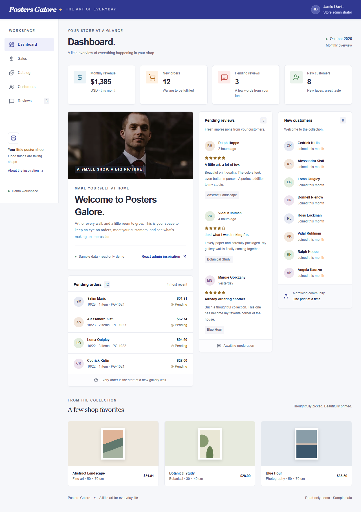

# Posters Galore Dashboard

A modern ecommerce dashboard for tracking storefront performance, pending orders, customer activity, and catalog highlights.

## Overview

This project showcases a polished admin dashboard experience built with React, Vite, and TypeScript. It includes:

- KPI summary cards for key business metrics
- Welcome and onboarding panel
- Pending orders and review tracking
- New customer insights
- Catalog preview section
- Responsive layout for desktop viewing

## Tech Stack

- React 19
- Vite
- TypeScript
- Tailwind CSS
- Lucide React icons

## Getting Started

1. Install dependencies:
   npm install

2. Start the development server:
   npm run dev -- --host 0.0.0.0 --port 4173

3. Open the app in your browser:
   http://localhost:4173/

## Build

To create a production build:

npm run build

## Project Structure

- src/app - application entry and layout
- src/features/dashboard - dashboard modules and widgets
- src/components - shared UI and layout components
- src/styles - global styling and dashboard theme

## Screenshot

The dashboard screenshot included above is saved in [screenshots/dashboard.png](screenshots/dashboard.png).
